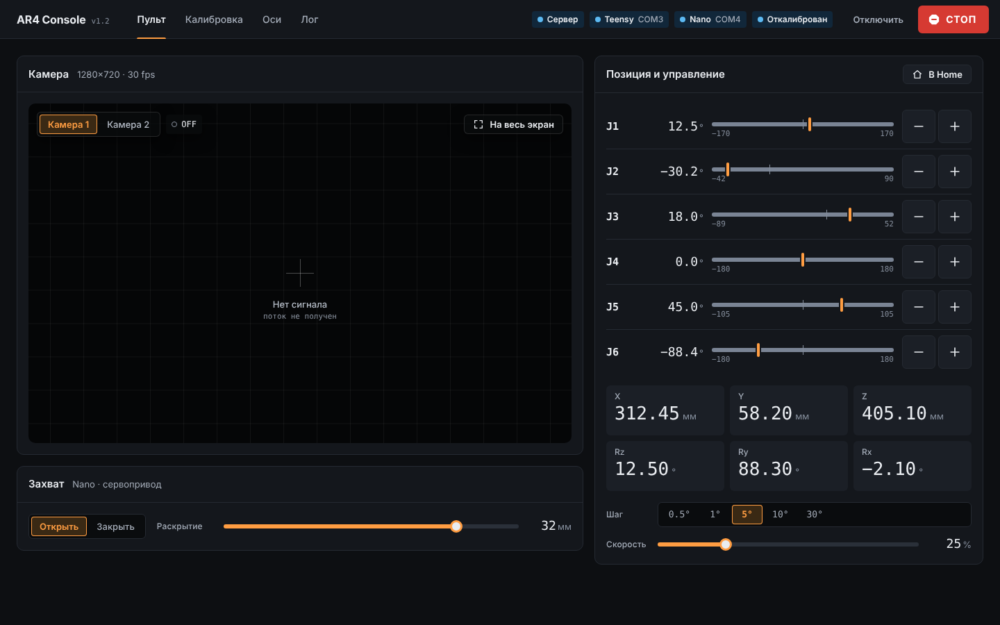

# AR4 Console — дизайн-система

Токены, стили и React-компоненты для интерфейса оператора манипулятора AR4. Правила оформления — в [GUIDELINES.md](GUIDELINES.md), описание каждого компонента — в `components/<Имя>/README.md`.



## Состав

| Путь | Что |
| --- | --- |
| `tokens.json` | Все значения: цвета двух тем, типографика, отступы, скругления, размеры |
| `tokens.css` | Те же значения как CSS-переменные (`--accent`, `--space-4`…) |
| `components/bundle.css` | Стили компонентов (классы `ar-*`), подключает шрифты Golos Text и JetBrains Mono |
| `components/bundle.js` | Компоненты для React 18, глобальный объект `window.AR4` |
| `components/index.d.ts` | Типы пропсов |
| `components/<Имя>/` | Описание и живое превью компонента; `Screen*` — макеты страниц |
| `screens/` | Скриншоты страниц в обеих темах |

## Подключение

```html
<link rel="stylesheet" href="tokens.css">
<link rel="stylesheet" href="components/bundle.css">
<script src="https://cdn.jsdelivr.net/npm/react@18.3.1/umd/react.production.min.js"></script>
<script src="https://cdn.jsdelivr.net/npm/react-dom@18.3.1/umd/react-dom.production.min.js"></script>
<script src="components/bundle.js"></script>
```

```js
const { Shell, AppHeader, NavTabs, EStop, JointRow } = window.AR4;
```

Тёмная тема («Цех») включена по умолчанию; светлая — `<html data-theme="light">`.

Без React можно использовать только `tokens.css` и `bundle.css`, размечая HTML классами `ar-*`.

## Страницы

Пульт · Калибровка · Оси · Лог — состав и порядок фиксированы, см. `components/Screen*/`.
